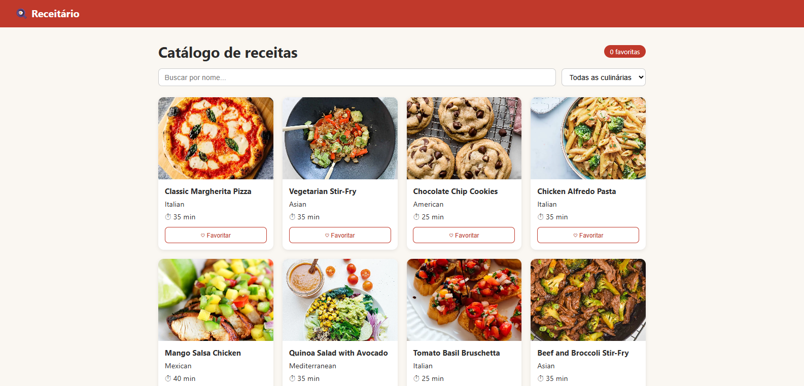

# Receitário

O Receitário é uma aplicação web desenvolvida para organizar e consultar receitas culinárias por meio de um catálogo.

## Tecnologias utilizadas

- **React:** construção da interface da aplicação.
- **TypeScript:** tipagem e organização do código.
- **Vite:** ferramenta de desenvolvimento e geração da versão de produção.
- **React Router DOM:** gerenciamento da navegação entre páginas.
- **HTML e CSS:** estrutura e estilização das páginas.

## Integrantes

| Nome | RM |
Diego Barbosa - RM568829
João Fontenele - RM570783
Vinicius Pacheco - RM571109
Yan Almeida - RM568814

## Deploy

🔗 fiap-receitario.vercel.app

## Print do catálogo



## Como rodar

```bash
npm install
npm run dev
```

## Build

```bash
npm run build
```

